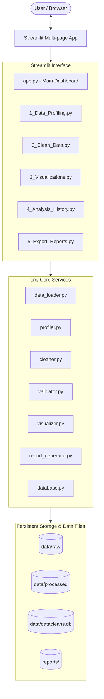

# DataCleans AI — Architecture & Implementation Plan

## 1. Project Overview & Objective

**DataCleans AI** is a professional portfolio project designed to showcase real-world Python engineering, automated data cleaning, exploratory data analysis (EDA), and interactive web application development.

The application allows users (data analysts, business users, researchers) to:
1. Upload tabular datasets (CSV, Excel).
2. Automatically generate comprehensive data health and quality profiles (missing values, duplicates, outliers, schema anomalies).
3. Apply configurable, step-by-step cleaning operations (imputation, deduplication, type casting, string normalization, outlier handling).
4. Inspect pre-cleaning vs post-cleaning comparisons and audit trails.
5. Generate interactive exploratory visualizations using Plotly and Seaborn.
6. Persist metadata and audit history using SQLite and SQLAlchemy.
7. Export cleaned datasets (CSV/Excel) and analytical summaries (HTML/PDF/Markdown).

---

## 2. Technical Stack

| Layer | Technologies |
| :--- | :--- |
| **Language & Runtime** | Python 3.12+ / 3.14 |
| **Web UI Framework** | Streamlit |
| **Data Processing** | Pandas, NumPy |
| **Visualization** | Plotly (interactive), Seaborn & Matplotlib (static) |
| **Persistence** | SQLite with SQLAlchemy 2.0 ORM |
| **Testing** | Pytest, unittest.mock |
| **Analysis / Notebooks** | Jupyter Notebook (`notebooks/data_cleaning_and_analysis.ipynb`) |
| **Environment Management** | `python-dotenv`, `venv` |

---

## 3. High-Level Architecture

---

## 4. Component Responsibilities

1. **`data_loader.py`**:
   - Safely parses and validates uploaded files or sample datasets (`.csv`, `.xlsx`).
   - Detects encodings, delimiters, and file sizes with graceful error handling.
2. **`profiler.py`**:
   - Generates summary statistics: row/column counts, memory usage, missing rate per column, duplicate row counts, and data types.
   - Detects skewness, outliers (IQR & Z-score), and cardinality.
   - Computes an overall "Data Quality Health Score" (0–100%).
3. **`cleaner.py`**:
   - Modular, non-destructive transformations (returns new DataFrames and records audit diffs).
   - Missing value imputation (mean, median, mode, constant, forward/backward fill, dropping).
   - Duplicate removal (subset or entire rows).
   - Whitespace stripping, case standardization, regex-based cleaning.
   - Data type casting (currency, datetime parsing, booleans).
   - Outlier remediation (clipping, removing, or flagging).
4. **`validator.py`**:
   - Validates data against user-defined rules or target schemas.
   - Checks range constraints, regex patterns, nullability, and unique constraints.
5. **`visualizer.py`**:
   - Plotly-powered interactive charts: missing value heatmaps, distributions, correlation matrices, box plots for outliers, and categorical count plots.
6. **`report_generator.py`**:
   - Compiles before-and-after audit logs into structured Markdown and HTML reports.
7. **`database.py`**:
   - SQLAlchemy ORM models (`DatasetAudit`, `CleaningStep`, `QualityMetric`).
   - Logs timestamped cleaning sessions and audit trails for auditability.

---

## 5. Development Roadmap

- [x] **Stage 1: Project Foundation (Current Stage)**
  - Environment inspection & dependency setup.
  - Complete project directory structure and configuration module.
  - Streamlit multi-page layout foundation with navigation & session state management.
  - Modular package skeletons with type hints and docstrings.
  - Sample dataset (`customer_churn_dirty.csv`) and data dictionary.
  - Automated tests setup verifying foundation modules.
- [ ] **Stage 2: Data Ingestion & Comprehensive Profiler Engine**
  - Robust file loading (CSV, Excel), auto-encoding detection.
  - Full profiling metrics: completeness, uniqueness, consistency, health score.
  - Interactive profile dashboard (Page 1).
- [ ] **Stage 3: Interactive Cleaning Engine & Pipeline Builder**
  - Granular cleaning operations with real-time preview and undo/redo capabilities.
  - Before-vs-After comparison cards and metrics.
- [ ] **Stage 4: Exploratory Data Visualizations**
  - Plotly distributions, correlation heatmaps, missing value matrices.
  - Filterable interactive visual exploration page.
- [ ] **Stage 5: History Tracking & Report Export**
  - SQLite persistence for cleaning recipes and dataset versions.
  - Downloadable cleaned files and PDF/HTML summary reports.
- [ ] **Stage 6: Portfolio Polish & Demonstration Notebook**
  - Standalone Jupyter notebook walking through an end-to-end analytical case study.
  - Final test coverage, code documentation, and screenshots.
